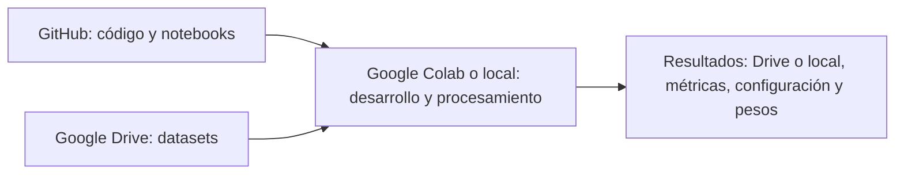

# MCD: Actividad de graduación. Detección de objetos extraños en cintas transportadoras de mineral

Proyecto de graduación grupal de Computer Vision y deep learning orientado a detectar automáticamente objetos extraños o voluminosos sobre cintas transportadoras de mineral, combinando datos reales de planta con datos simulados.

**Equipo:** Alfredo Vega, Cristian Medina, David Mamani y Patrick Vásquez.

**Enlaces:**
- [GitHub Repo: Código](https://github.com/patrickjvsa/afg-cv-mining-conveyor-belts)
- [Google Drive: Datos](https://drive.google.com/drive/folders/1lgVshy1lKk4bA6js3ugstGjjZgHLDYEp?usp=sharing)

## Contexto del problema

El proyecto aborda el riesgo que representan los objetos extraños que circulan junto al mineral hacia los equipos de procesamiento. Su presencia puede provocar daños en equipos, cortes de cinta y detenciones no programadas, afectando la continuidad operacional.

La propuesta surge de las dificultades de inspeccionar visualmente cintas en movimiento en un entorno industrial con polvo y variaciones en la apariencia de los materiales.

## Comenzar a trabajar

1. Abra [00_setup.ipynb](notebooks/00_setup.ipynb) en [Google Colab](https://colab.research.google.com/) mediante **Archivo → Abrir notebook → GitHub**.
2. Complete únicamente la sección 1 y ejecute las celdas en orden. El notebook prepara código, dependencias, Drive y datos.
3. Al terminar, use `DATA_PATH` para comenzar a explorar los datos en esa sesión. Todavía no hay un flujo común de modelado o evaluación; cada integrante desarrolla su trabajo en su rama.

La [guía del equipo](docs/guia_equipo.md) reúne instrucciones de Drive, Colab, Git y solución de problemas.

## Notebook de preparación

[00_setup.ipynb](notebooks/00_setup.ipynb) comprueba el entorno, clona el código, instala dependencias, monta Drive y valida los datos. Permite preparar una copia local opcional. Termina al dejar `DATA_PATH` disponible; no crea salidas ni guarda resultados.

Si abre otro notebook, Colab puede asignarle una máquina diferente. No presuponga que compartirá las variables o el disco de la sesión anterior.

## Dónde vive cada cosa



GitHub conserva código y documentación; Drive conserva los datos compartidos; Colab ejecuta el código. Una desconexión puede borrar su disco temporal. El setup utiliza Drive para lectura y no implementa guardado automático de resultados.

```text
├── README.md
├── requirements.txt
├── .gitignore
├── data/                           # Datasets
│   └── README.md
├── notebooks/                      # Notebooks
│   └── 00_setup.ipynb
├── src/                            # Utilidades internas de los notebooks
└── docs/
    └── guia_equipo.md
```

## Datos y configuración

En su computador, coloque los datasets en `data/raw/`; vea [data/README.md](data/README.md). En Colab, el origen persistente es la carpeta compartida de Drive:

- Con `copy_to_local=False`, se leen los archivos directamente desde Drive.
- Con `copy_to_local=True`, se prepara una copia en `data/prepared/data/` dentro del clon temporal.

En ambos casos el código utiliza `DATA_PATH`. Los datos quedan excluidos de Git.

La configuración está en una celda de `00_setup.ipynb`: repositorio, rama, rutas de datos y opciones de validación y copia. No hay archivos YAML adicionales ni es necesario definir parámetros de entrenamiento para explorar. La preparación local rechaza sobrescrituras accidentales.

## Trabajo en equipo

Cada integrante trabaja en su rama y solicita revisión antes de integrar cambios. Acuerden quién edita cada notebook, borren sus salidas antes de enviarlo y no suban datos, pesos ni credenciales. El flujo Git y los comandos están en la [guía del equipo](docs/guia_equipo.md).
