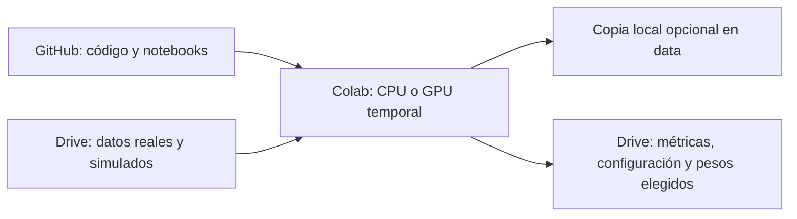

# MCD: Actividad de graduación. Detección de objetos extraños en cintas transportadoras de mineral

Proyecto de graduación grupal de Computer Vision y deep learning orientado a detectar automáticamente objetos extraños o voluminosos sobre cintas transportadoras de mineral, combinando datos reales de planta con datos simulados.

**Equipo:** Alfredo Vega, Cristian Medina, David Mamani y Patrick Vásquez.

**Enlaces:**
- [GitHub Repo: Código](https://github.com/patrickjvsa/afg-cv-mining-conveyor-belts)
- [Google Drive: Datos](https://drive.google.com/drive/folders/1lgVshy1lKk4bA6js3ugstGjjZgHLDYEp?usp=sharing)

## Contexto del problema

El proyecto aborda el riesgo que representan los objetos extraños que circulan junto al mineral hacia los equipos de procesamiento. Su presencia puede provocar daños en equipos, cortes de cinta y detenciones no programadas, afectando la continuidad operacional.

La propuesta surge de las dificultades de inspeccionar visualmente cintas en movimiento en un entorno industrial con polvo y variaciones en la apariencia de los materiales.

## Estado actual del repositorio

Está implementada la infraestructura de trabajo colaborativo: preparación del entorno, acceso a datos, validación general de archivos y registro reproducible de experimentos con GitHub, Google Drive y Google Colab. El repositorio permite asociar los resultados a una configuración, un commit de código y una versión del dataset.

Quedan por definir e implementar la captura de imágenes reales, la generación de datos simulados, las clases y reglas de anotación, las particiones de evaluación y los modelos de detección. Los objetos mencionados arriba son ejemplos del problema, no una lista definitiva de clases. Los notebooks actuales preparan y exploran los datos y consultan resultados; todavía no entrenan un detector.

La infraestructura utiliza herramientas gratuitas y no requiere servicios de pago. Los recursos gratuitos de Colab tienen disponibilidad variable.

## Comenzar a trabajar

1. Obtenga del responsable la URL del repositorio, la rama, el acceso a Drive y la versión del dataset.
2. Abra [00_setup.ipynb](notebooks/00_setup.ipynb) en [Google Colab](https://colab.research.google.com/) mediante **Archivo → Abrir notebook → GitHub**.
3. Complete únicamente la sección 1 y ejecute las celdas en orden. El notebook prepara código, dependencias, Drive y datos.
4. En la última sección encontrará cómo continuar con los pasos 01 y 02 en la misma sesión, sin repetir la configuración.

La [guía del equipo](docs/guia_equipo.md) reúne las instrucciones de Drive, Colab, Git y solución de problemas. No necesita editar las utilidades de `src/` para comenzar.

## Notebooks por pasos

| Paso | Qué hace |
|---|---|
| [00 · Preparar](notebooks/00_setup.ipynb) | Configurar el proyecto, montar Drive, validar datos y preparar las salidas. |
| [01 · Explorar](notebooks/01_exploracion_datos.ipynb) | Inspeccionar archivos y visualizar una muestra de imágenes. |
| [02 · Consultar resultados](notebooks/02_evaluacion.ipynb) | Leer registros de experimentos y revisar sus métricas cuando existan. |

Abrir otro notebook en Colab puede asignar una máquina diferente. Para conservar la sesión, después del paso 00 añada una celda con `run_step("01_exploracion_datos.ipynb")`. Para consultar resultados use `run_step("02_evaluacion.ipynb")`. Los notebooks permanecen separados para leer y desarrollar cada etapa.

## Dónde vive cada cosa



GitHub conserva código y documentación; Drive conserva datos y resultados; Colab ejecuta el código. Una desconexión puede borrar el disco de Colab: guarde los resultados importantes explícitamente en Drive y compruebe que llegaron.

```text
├── README.md
├── requirements.txt
├── .gitignore
├── data/
│   └── README.md
├── notebooks/
│   ├── 00_setup.ipynb
│   ├── 01_exploracion_datos.ipynb
│   └── 02_evaluacion.ipynb
├── src/
│   └── cv_project/       Utilidades internas de los notebooks
└── docs/
    └── guia_equipo.md
```

## Datos y configuración

En su computador, coloque los datasets en `data/raw/`; vea [data/README.md](data/README.md). En Colab, el origen persistente es la carpeta compartida de Drive:

- Con `copy_to_local=False`, se leen los archivos directamente desde Drive.
- Con `copy_to_local=True`, se prepara una copia en `data/prepared/data/` dentro del clon temporal.

En ambos casos el código utiliza `DATA_PATH`. Los datos quedan excluidos de Git.

La configuración está en una celda de `00_setup.ipynb`: rutas, versión de datos, semilla y futuros hiperparámetros. No hay archivos YAML adicionales. Al registrar un experimento, las utilidades guardan su configuración, commit, versión de datos y métricas en Drive. Las copias y exportaciones rechazan sobrescrituras accidentales.

## Trabajo en equipo

Cada integrante trabaja en su rama y solicita revisión antes de integrar cambios. Acuerden quién edita cada notebook, borren sus salidas antes de enviarlo y no suban datos, pesos ni credenciales. El flujo Git y los comandos están en la [guía del equipo](docs/guia_equipo.md).

No se incluyen tests ni automatizaciones de CI en esta versión mínima. La guía contiene un checklist breve para verificar los cambios y las integraciones reales de Colab antes de experimentar.
