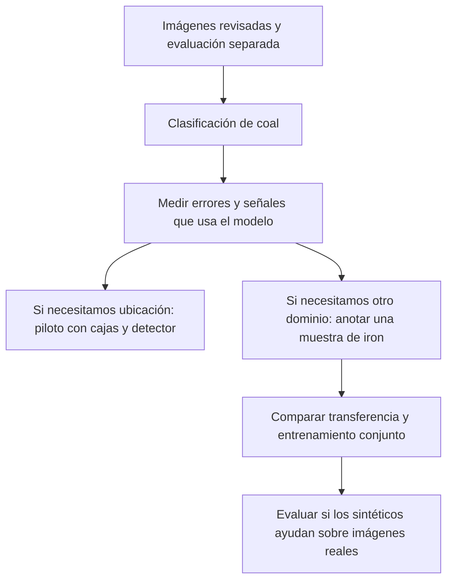

# Guía práctica para comenzar este proyecto de computer vision

**Recomendación para la entrega próxima:** usar `coal` limpio para entrenar un primer clasificador con ResNet-18 preentrenada, compararlo con una referencia sencilla y explicar sus errores. Explorar `iron` y proponer cómo anotarlo. La combinación, las imágenes sintéticas y el detector con cajas vienen después.

Esta recomendación responde a la pauta compartida: presentar primeros pasos de modelado, decisiones y aprendizajes. Esa pauta no exige un detector terminado, una arquitectura específica ni usar todos los datos. Si otra rúbrica exige localización con cajas, habrá que incorporar un piloto de detección; no se desprende del texto que revisamos.

El [plan de notebooks](plan_exploracion_modelado.md) contiene la auditoría y el detalle de implementación. Esta guía explica las decisiones para alguien que está empezando.

## 1. Primero elegir qué pregunta debe responder el modelo

| Tarea | Ejemplo de respuesta | Etiquetado habitual para entrenamiento supervisado | Aplicación aquí |
|---|---|---|---|
| Clasificación de imagen | «Esta imagen muestra un perno» | Una clase por imagen; sin cajas | Primer modelo sobre coal |
| Detección de objetos | «Hay un perno en este rectángulo y un bloque en este otro» | Clase y bounding box de cada objeto objetivo | Cuando necesitemos localizar o reconocer varios objetos |
| Segmentación | «Estos píxeles pertenecen a la madera» | Máscara del objeto o de la región | Opcional si necesitamos contornos o recortes precisos |

Una **bounding box** es un rectángulo que rodea el objeto. Una **máscara** sigue su contorno píxel a píxel. No necesitamos ambas para todos los modelos. El [tutorial de detección de TorchVision](https://docs.pytorch.org/tutorials/intermediate/torchvision_tutorial.html) ilustra la supervisión por objetos y la diferencia entre cajas y máscaras.

En clasificación, la entrada sigue siendo la imagen completa: no hay que recortar cada objeto previamente. Podemos aprender a responder si una imagen contiene una condición de riesgo y después decidir si localizarla agrega el valor que necesitamos. La clasificación también puede fallar por apoyarse en el fondo; por eso tendremos análisis de errores y experimentos con el texto.

La clasificación inicial de tres clases supone que podemos dar una etiqueta principal a cada imagen de coal. Si en la revisión encontramos bloque y perno a la vez, no conviene inventar una prioridad silenciosa: registrar el caso y decidir si se excluye del primer experimento o si más adelante pasamos a múltiples etiquetas o detección.

## 2. Qué etiquetar ahora y cómo hacerlo después

**En coal ya tenemos etiquetas de imagen**, dadas por las carpetas. El trabajo inicial es auditarlas, no volver a dibujar 4.800 imágenes: hay 65 grupos de contenido idéntico con clases contradictorias. Se excluyen o corrigen con evidencia y se documenta el cambio. La certeza técnica de que son el mismo archivo no nos dice cuál es la etiqueta correcta.

**En iron todavía necesitamos etiquetas de imagen** para un experimento supervisado. Podemos empezar marcando presencia real de madera, estado normal u objeto incierto en una muestra temporal. Poner «madera» a todos los fotogramas de una carpeta `wood` produciría etiquetas equivocadas. Ese etiquetado puede vivir en un CSV y no requiere cajas mientras la pregunta sea de clasificación.

Si pasamos a un detector, el flujo propuesto es:

1. Escribir reglas: clases, qué se considera sobretamaño, cómo tratar oclusiones, objetos cortados y casos inciertos. Sin escala no podemos convertir tamaño aparente en centímetros.
2. Seleccionar inicialmente 200–400 imágenes variadas y poco redundantes. Es un piloto para aprender y estimar esfuerzo, no una cifra que garantice buen desempeño. Incluir normales y distintos eventos de riesgo.
3. Separar eventos entre train, validación y test antes de propagar anotaciones o crear derivados. No elegir cientos de vecinos del mismo perno como si fueran objetos independientes.
4. Dibujar una caja por cada objeto de las clases que nos comprometimos a detectar. Un fotograma negativo verificado no lleva una caja ficticia de «normal»: es una imagen sin objetos objetivo. En YOLO se representa sin anotaciones de objetos, según el [formato oficial](https://docs.ultralytics.com/datasets/detect/).
5. Revisar que todas las instancias objetivo estén anotadas. Un objeto presente pero sin caja puede convertirse en supervisión equivocada de fondo. Los casos inciertos deben quedar separados del entrenamiento normal.
6. Revisar una fracción con otra persona y corregir sistemáticamente los desacuerdos. Las reglas deben servir para el conjunto completo, no cambiar imagen a imagen.

Se puede dibujar con una herramienta de anotación; no hace falta programar una interfaz en el notebook. [CVAT permite dibujar rectángulos](https://docs.cvat.ai/docs/annotation/manual-annotation/shapes/annotation-with-rectangles/) y ofrece [asistencia con modelos](https://docs.cvat.ai/docs/annotation/auto-annotation/ai-tools/). Las funciones disponibles dependen de la instalación y configuración.

**Mi recomendación es empezar manualmente con un lote pequeño y luego asistir el trabajo**, de dos maneras posibles:

- En tramos realmente consecutivos, proponer seguimiento/interpolación entre anotaciones y revisar resultados, especialmente cuando el objeto entra, sale o queda oculto. Los saltos de índices que encontramos requieren cortar o revisar el tramo.
- Tras tener un primer modelo entrenado con anotaciones revisadas, generar propuestas para otro lote y aceptarlas, corregirlas o rechazarlas. Un segmentador interactivo también puede ayudar a obtener máscaras para recortes; no determina por sí mismo la clase ni el riesgo.

Las etiquetas automáticas son propuestas, no verdad de referencia. Si un modelo las produce y luego se evalúa contra esas mismas propuestas, la evaluación pierde independencia. Las anotaciones de validación/test necesitan revisión humana y no deben aceptar una predicción solo porque tiene confianza alta.

## 3. Qué modelo usar y qué significa preentrenado

Para la entrega recomiendo **ResNet-18 preentrenada en ImageNet**, con una salida nueva para nuestras tres clases. Preentrenado significa que parte de un modelo que ya aprendió características visuales con otras imágenes. Eso no significa que ya sepa reconocer nuestros pernos: debemos adaptar y evaluar su salida. La [documentación de los pesos de ResNet-18](https://docs.pytorch.org/vision/stable/models/generated/torchvision.models.resnet18.html) especifica los pesos y la normalización asociados.

El camino es gradual:

- **Referencia M0:** un clasificador trivial, para saber qué obtiene una regla que no aprende de las imágenes. El balance original de coal no debe confundirse con el balance después de limpiar.
- **Primer modelo M2:** conservar fija la parte que extrae características y entrenar únicamente la capa de salida. Es el primer experimento que priorizaría.
- **Mejora M3, si hay tiempo:** permitir que el último bloque también cambie, usando un ritmo de aprendizaje menor. Esto se llama fine-tuning. Comparar si aporta en validación o solo mejora entrenamiento.

Estas dos formas de transferencia están descritas en la [guía oficial de PyTorch](https://docs.pytorch.org/tutorials/beginner/transfer_learning_tutorial.html). La regresión logística sobre métricas de imagen del plan es un diagnóstico adicional; no hace falta completar todos los candidatos antes de tener una CNN funcionando.

Para una fase posterior de **detección con cajas**, la propuesta concreta es ajustar **YOLO11n**, una variante pequeña documentada en la [familia YOLO11](https://docs.ultralytics.com/models/yolo11/). Es un punto de partida propuesto, no una afirmación de que será el mejor detector ni de que sea la versión más nueva. Faster R-CNN queda como alternativa si se prefiere el ecosistema TorchVision. No recomiendo entrenar ambos al comenzar.

Cambiar ResNet por YOLO no elimina el trabajo de anotación. Los pesos genéricos de un detector tampoco garantizan reconocer los objetos específicos de nuestras cintas.

## 4. Cómo trabajar con el texto sobreimpreso

En las muestras de coal vimos fechas, horas y mensajes de alarma. **No podemos asumir que sean inofensivos ni que expliquen ya todas las etiquetas.** El riesgo es que el modelo reconozca un mensaje del sistema previo, su color o su posición, en vez del objeto que queremos detectar.

Para este proyecto propondría tratar esos textos como información ajena a la evidencia visual que debe justificar la alarma:

1. En el conjunto de desarrollo, marcar presencia y posición del texto y revisar si se asocia con una clase o un encuadre. Basta empezar con inspección manual de una muestra; OCR no es un requisito.
2. Proponer una región de cinta o zonas fijas para ocultar overlays, definidas a partir de train. Comprobar que ninguna borre objetos relevantes. Un recorte es útil solo si conserva la información necesaria.
3. Si hay zonas seguras, producir una variante sin texto con el mismo criterio para todas las clases y para train/validación/test. No tapar únicamente positivos: el parche podría revelar la etiqueta. Si cambian los encuadres, documentar reglas por configuración visual, sin usar la clase verdadera para elegirlas.
4. Comparar en validación dos entrenamientos: uno con las imágenes originales y otro con el tratamiento del texto aplicado desde entrenamiento. Mantener el resto del protocolo igual. No basta entrenar con texto y taparlo solo durante la evaluación: ese cambio de entrada también puede reducir desempeño por otros motivos.
5. Examinar errores y, opcionalmente, mapas de activación. Si el modelo funciona peor al eliminar overlays, investigar; eso es una señal, no una prueba única de dependencia del texto.

Para la ruta principal prefiero una entrada sin overlays **si podemos obtenerla sin esconder el objeto**. Si no es posible, se mantiene una referencia con las limitaciones explícitas y se priorizan imágenes o regiones donde la evaluación sea defendible. No hace falta empezar con reconstrucción generativa de la zona tapada: añadiría contenido inventado y otra fuente de artefactos.

Fecha/hora podrían ayudar a reconstruir grupos de captura si son legibles y fiables; no se usarían como variables predictoras de riesgo. Tampoco convertiremos el texto de alarma existente en etiqueta automática del nuevo modelo.

## 5. Combinar datos y crear sintéticos son experimentos distintos

| Operación | Qué significa | Recomendación |
|---|---|---|
| Augmentation | Variar ligeramente brillo, contraste o desenfoque de una imagen de train | Sí, con revisión visual y cambios moderados |
| Entrenamiento conjunto real | Entrenar un modelo con imágenes reales etiquetadas de ambos orígenes | Después de definir etiquetas compatibles y evaluaciones separadas |
| Transferencia entre dominios | Adaptar a iron un modelo que aprendió con coal | Buen experimento posterior con una muestra etiquetada de iron |
| Síntesis por copy-paste | Crear una imagen nueva insertando un objeto recortado en otro fondo | Piloto posterior, empezando dentro del mismo dominio |

**Para la entrega próxima mantendría separados coal e iron en el modelado.** Ambos participan de la exploración; eso ya permite explicar qué aporta y qué le falta a cada uno. Todavía no tenemos las etiquetas de iron necesarias para atribuirle una mejora a la mezcla.

Más adelante sí podríamos compartir una salida normal/riesgo, manteniendo el origen y las clases originales. Habría que acordar qué es riesgo en cada dominio. «Perno» y «madera» no son la misma clase; podemos agregarlos a una categoría operacional sin borrar esa diferencia. Entrenar con ambas no garantiza generalizar a otra cámara: el modelo podría aprender qué dataset está mirando.

El experimento de mezcla necesita un test real de cada dominio, separado por eventos. Comparar solo coal, solo iron y ambos con el mismo presupuesto de etiquetas de iron. Reportar resultados por origen; una media global puede ocultar que mejoró un conjunto y empeoró el otro. La cantidad de fotogramas de iron no debe decidir su peso en el entrenamiento.

**Sí podemos investigar un dataset sintético**, pero una imagen con un perno no nos entrega automáticamente el perno recortado. Para copy-paste necesitamos una máscara del objeto, o un recorte cuidadosamente revisado, y un fondo confirmado sin riesgo.

Un primer piloto sensato sería insertar madera de train de iron en otros fondos de train de iron, si las anotaciones confirman que disponemos de objetos y fondos adecuados. El [estudio de Copy-Paste](https://arxiv.org/abs/2012.07177) muestra que la técnica puede aportar en segmentación; aquí su beneficio debe medirse. Insertar pernos de coal en iron es más difícil por la diferencia de perspectiva, resolución, iluminación y textura.

Todos los padres de una composición deben venir del train. Una composición no aporta un objeto físico independiente: sigue siendo un derivado de sus fuentes. Compararemos entrenamiento real frente a real más sintético, con validación y test reales intactos. Si el modelo reconoce bordes de recorte y no objetos reales, el sintético no está ayudando.

## 6. Hasta dónde llegar para la próxima entrega

**Alcance que recomiendo comprometer:**

1. Exploración de ambos datasets con ejemplos, conteos y dificultades concretas.
2. Coal saneado: conflictos excluidos o resueltos con registro y particiones que separen contenidos/eventos conocidos.
3. Un preprocesamiento justificado que examine texto sobreimpreso y visibilidad de los objetos.
4. M0 y ResNet-18 con extractor congelado ejecutados. Si el texto es un riesgo relevante y podemos tratarlo sin perder objetos, priorizar su comparación antes de agregar otra arquitectura.
5. Matriz de confusión, precision/recall por clase, macro-F1 y ejemplos de falsas alarmas y anomalías omitidas. Explicar validación frente a test: validación permite decidir; test se reserva para evaluar el protocolo ya elegido.
6. Una conclusión respaldada: qué aprendimos, dónde falla y qué cambiaríamos después. Mostrar dificultades reales de ejecución si ocurrieron, sin inventarlas para completar el relato.

**Ampliación prioritaria si eso ya está completo:** fine-tuning del último bloque. Después, un piloto de etiquetas por imagen en iron. No comprometería mezcla de dominios, síntesis ni un detector con cajas para esta entrega a partir de los datos que tenemos hoy.

No hace falta alcanzar una precisión arbitraria para demostrar primeros pasos serios. Es más defendible un resultado modesto con etiquetas y evaluación revisadas que uno aparentemente excelente con duplicados o fotogramas del mismo evento repartidos entre train y test.

La redacción esperada sería algo como: «Formulamos una primera clasificación de condiciones en coal. Auditamos las etiquetas y separamos los datos para reducir contaminación. Probamos una referencia y transferencia con ResNet-18; presentamos sus métricas y errores. Iron requiere anotación adicional y queda como siguiente experimento de transferencia. La localización con cajas es una etapa posterior». Esa formulación deberá completarse con los resultados realmente obtenidos.

La entrega mostraría así un ciclo completo de trabajo: entender los datos, formular una tarea posible, preparar una evaluación, entrenar y aprender de los errores. Eso deja una base concreta para decidir si el siguiente esfuerzo debe ir a más anotaciones, a detección espacial o a transferencia entre datasets.

## 7. ¿Tiene sentido un modelo que sirva para ambos datasets?

**Sí, como experimento de aprendizaje supervisado en dos dominios conocidos. No tenemos evidencia todavía de que superará a dos modelos separados ni de que reconocerá cualquier objeto extraño en otra planta.** Esas son preguntas diferentes.

Aquí un dominio es un conjunto de condiciones visuales: cámara, perspectiva, mineral, iluminación y entorno. Coal e iron difieren tanto en esas condiciones como en los objetos que muestran. Redimensionar imágenes o pasarlas a escala de grises puede uniformar la entrada; no elimina las diferencias ni completa etiquetas faltantes.

### 7.1. Qué significa «servir para ambos»

| Objetivo | ¿Tiene sentido investigarlo con estos datos? | Qué permitiría demostrar |
|---|---|---|
| Clasificar normal/riesgo en nuevas imágenes de ambos orígenes | Sí, después de anotar iron y acordar riesgo | Desempeño de un modelo en esos dos dominios, con eventos reservados |
| Reconocer perno, bloque y madera con una taxonomía común | Posible, requiere revisar clases, coexistencia y anotaciones | Reconocimiento de las clases y combinaciones realmente evaluadas |
| Entrenar solo con coal y esperar reconocer madera en iron | Solo como prueba exploratoria de transferencia a anomalías no vistas | Si el modelo detecta esa condición particular; no reconocimiento aprendido de madera |
| Detectar cualquier objeto extraño en cualquier planta | Estos datasets no sustentan esa afirmación | Requiere nuevos objetos, cámaras y plantas de evaluación |

Para empezar, escogería el primer objetivo: una salida binaria normal/riesgo en ambos orígenes, conservando el tipo de objeto para analizar errores. No hace falta sintetizar imágenes para investigar esto. Tampoco hace falta usar cajas si seguimos trabajando con clasificación por imagen.

Las diferencias entre clases y cámaras merecen especial atención: si solo hay pernos en coal y madera en iron, el modelo podría aprender reglas distintas según el fondo. Eso puede funcionar en los dos entornos conocidos, pero no demuestra que reconocerá pernos en iron o madera en coal. Probar esas combinaciones exige ejemplos reales reservados de ellas; una composición sintética por sí sola no las valida.

### 7.2. Experimento que justificaría mantener un modelo conjunto

1. Preparar coal y una muestra de iron etiquetada por imagen. Verificar que cada dominio tenga normales y riesgos evaluables en eventos separados; si falta soporte, reducir el objetivo en vez de inventar etiquetas.
2. Reservar validación y test reales por dominio. Comprobar eventos y posibles objetos físicos compartidos entre tomas, además de hashes.
3. Mantener la misma arquitectura y comparar tres entrenamientos: solo coal, solo iron y coal + iron. Usar los mismos datos disponibles por origen y registrar cualquier repetición/muestreo para controlar el desequilibrio. Mantener un presupuesto de optimización comparable y registrar las exposiciones por dominio.
4. Evaluar los tres en cada test y reportar una matriz modelo × dominio, con recall de riesgos, falsas alarmas y macro-F1. Seleccionar con validación; test confirma el protocolo fijado. Los resultados cruzados son transferencia, no un sustituto de la evaluación dentro de cada dominio.
5. Comparar el conjunto también contra la alternativa práctica de dos especialistas, uno por dominio conocido. Un modelo único puede ser útil por mantenimiento aun si no supera todas las métricas, pero el compromiso debe quedar explícito.
6. Elegir de antemano si la salida usa un umbral global o umbrales calibrados por dominio. En el segundo caso, declarar que el sistema necesita identificar el dominio. Acordar con validación qué caída por dominio sería tolerable; no declarar éxito solo porque sube el promedio.

Una primera combinación razonable es entrenamiento supervisado conjunto con batches que representen ambos dominios. No partiría por adaptación adversarial ni traducción de estilo. El estudio [In Search of Lost Domain Generalization](https://arxiv.org/abs/2007.01434) refuerza la importancia de comparar baselines y controlar selección/evaluación; no prueba que nuestra mezcla funcionará.

Si no mejora, las alternativas incluyen conservar especialistas o compartir un extractor visual con salidas separadas por dominio. Esta última opción permite compartir entrenamiento sin exigir clases idénticas, pero no equivale a una única regla universal de riesgo. Tampoco hay obligación de usar ambos datasets en el modelo final: su selección debe responder a resultados y al entorno objetivo.

### 7.3. Qué llamamos sintético, concretamente

En esta propuesta, **sintético significa una imagen de entrenamiento construida artificialmente**, principalmente por composición de partes de imágenes reales. Conviene distinguir:

| Tipo | Ejemplo en el proyecto | Qué agrega y qué no |
|---|---|---|
| Transformación de una imagen real | Cambiar brillo o añadir desenfoque moderado | Condiciones simuladas; no otro objeto físico ni otra cámara real |
| Composición o copy-paste | Insertar una madera recortada en otra imagen de cinta | Nueva combinación objeto–fondo; conserva las limitaciones de las vistas disponibles |
| Render 3D | Renderizar cinta, mineral y pernos con cámaras virtuales | Control de geometría y etiquetas; exige construir y validar la simulación |
| Generación con un modelo de imágenes | Generar una cinta con objetos a partir de instrucciones | Apariencia nueva; posición, identidad y realismo necesitan verificación |

El plan actual propone únicamente investigar copy-paste después de los baselines. Un cambio de brillo se reportaría como augmentation, no como un segundo dataset independiente. Grabar una escena física colocando madera sobre una cinta sería una captura real escenificada, no una imagen generada; no conocemos la procedencia suficiente para asignar esa descripción a iron.

Ejemplo de copy-paste: tomar una madera del train de iron, obtener su máscara, insertarla sobre un fondo también de train verificado sin riesgo y registrar fuentes y transformación. La máscara transformada permite calcular una caja de la región insertada; esa anotación describe la composición, no demuestra que su apariencia sea realista. Ajustar también las anotaciones de objetos preexistentes si hay oclusiones.

Pasar de coal a iron es más difícil: rotar o deformar un perno recortado no recupera automáticamente la vista desde otra cámara. Además de tamaño, habría que revisar iluminación, textura, sombras y oclusión. Por eso no considero los sintéticos una solución previa al problema de combinar dominios.

Solo después del entrenamiento conjunto real añadiría una cuarta variante: conjunto real + sintéticos, con los mismos tests reales. Así distinguimos si ayudó usar otro dataset o si ayudó la composición. Controles sin inserción y revisión de errores ayudan a identificar artefactos de pegado. La [evidencia original de Copy-Paste](https://arxiv.org/abs/2012.07177) motiva ese experimento; su éxito en otros datos no garantiza el nuestro.

**Decisión recomendada:** conservar el objetivo de investigar un modelo para ambos como segundo hito formal. Primer hito: coal con evaluación limpia. Segundo: piloto etiquetado de iron y comparación de especialistas frente a modelo conjunto. Tercero, solo si existe una carencia concreta que abordar: síntesis. Para una aplicación en una planta distinta de ambos orígenes, además hará falta una muestra de esa planta para evaluar transferencia.
